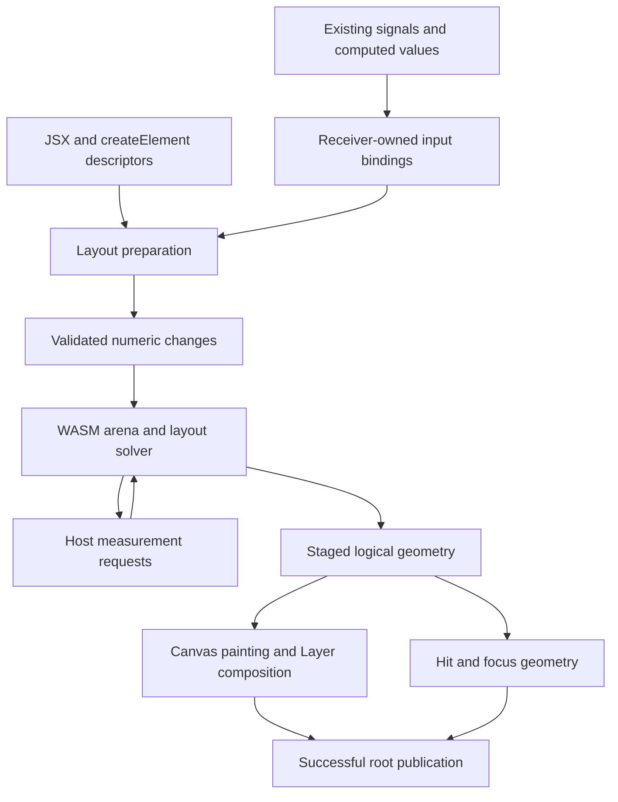

# Proposed Pibbl layout architecture

Status: proposed design, 2026-10-21. All new signatures below are design sketches,
not available exports. No runtime changes are authorized by this document.
See the [integration plan](../../../project-plans/layout-engine-rework-proposal.md),
[Yoga research](./yoga-research.md), and [reactivity design](./reactivity.md).

## Recommended shape

Build a Pibbl-owned layout system with a **persistent numeric layout graph in
WASM**, a small TypeScript adapter integrated into the existing signal graph and
scheduler, and the existing immediate Canvas renderer. Rust is the recommended
kernel language because Pibbl already has a Rust/WASM build path and it supports
explicit arenas, native tests, and algorithm reuse. This is an engineering choice,
not evidence that Rust is automatically faster than C++ or AssemblyScript.

Own the protocol, lifecycle, semantics, and tests. Select fresh algorithms versus
internal reuse of Taffy's low-level algorithms after a bounded feasibility slice.
Do not expose that choice in application APIs. Yoga remains a test oracle and
migration target, not a required runtime dependency.

The eventual kernel owns Flex, Grid, Flow, Overlay, and Absolute geometry, including
intrinsic sizing, line/track allocation, edge resolution, and layout caching.
JavaScript owns signal evaluation, component identity, resource callbacks, Canvas
text measurement, and painting. Browser-owned measurement cannot simply be moved
into WASM. Optional text shaping may use `@pibbl/text`, without making HarfBuzz
mandatory for ordinary Canvas Text.



The graph stores style, topology, measurement keys, and geometry. It stores no
Canvas drawing commands, Three scene objects, HTML, event handlers, or signal
objects. This is a deliberate amendment to layout's current entirely immediate
allocation model, while preserving immediate painting and explicit bitmap Layers.

## Authoring and defaults

Retain `Flex`, `Grid`, `Flow`, `Overlay`, and `Absolute`, automatic JSX, and
`createElement`. Retain readable named style properties, direct signal inputs,
and explicit `.get()` reads. Do not require application authors to create,
mutate, synchronize, and free layout nodes for ordinary Pibbl composition.

Proposed ordinary authoring:

```tsx
const sidebarWidth = signal(240);

function Workspace() {
  return (
    <Flex style={{ width: "100%", height: "100%", gap: 16 }}>
      <Flex
        style={{ width: sidebarWidth, flexShrink: 0, flexDirection: "column" }}
      >
        <Text>Projects</Text>
      </Flex>
      <Flex style={{ flexGrow: 1, minWidth: 0, flexDirection: "column" }}>
        <Text style={{ wrap: true }}>
          Content wraps at the final allocated width.
        </Text>
      </Flex>
    </Flex>
  );
}
```

The replacement removes the current requirement to supply explicit main-axis
minimums merely to use automatic basis or shrinking. Explicit `minWidth: 0`
remains meaningful when an app wants to shrink below its content-based minimum.

Recommended native defaults:

| Property          | Proposed default/contract                                      | Migration consequence                                                                     |
| ----------------- | -------------------------------------------------------------- | ----------------------------------------------------------------------------------------- |
| Flex direction    | `row`, preserving Pibbl                                        | Yoga-default imports explicitly set `column`.                                             |
| Grow/shrink/basis | `0`, `1`, `auto`                                               | Yoga-default imports explicitly set shrink zero.                                          |
| Box sizing        | Preserve Pibbl `content-box`; add explicit `border-box`        | Yoga imports set border-box. Do not silently change every existing width.                 |
| Minimum size      | `auto` with specified content-based rules                      | This changes some existing layouts; migration can emit zero minimums where appropriate.   |
| Direction         | Root LTR; explicit nearest layout ancestor direction inherited | Direction inheritance is a narrowly defined layout rule, not a new general style cascade. |
| Gaps              | Zero; numeric and percentage values                            | Percentage basis must be defined for definite and intrinsic cases.                        |
| Layout rounding   | Unrounded logical geometry                                     | Yoga migration can request its tested pixel-grid policy separately.                       |
| Paint order       | Source order regardless of reverse axis                        | Reversal changes placement, not stacking, event priority, or tab order.                   |

Keep current alignment defaults unless a named compatibility profile supplies
different ones. Freeze all defaults in a machine-readable manifest before parity
work; do not rely on whichever defaults an underlying algorithm library happens
to use.

## Style semantics to specify and test

### Boxes and units

Use logical Canvas units, finite numeric values, percentage strings, and typed
intrinsic keywords. The kernel represents lengths as tagged values; undefined,
auto, and unbounded constraints are not encoded as arbitrary NaN values.
Preserve `number | Percentage | 'auto'` and add `min-content`, `max-content`,
`stretch`, and an explicitly bounded fit-content representation where valid.
Not every length keyword is legal for every property.

Add `boxSizing`, `aspectRatio`, margin, logical edges, percentage padding/gaps,
and layout border widths. **Layout border width and painted `strokeWidth` are
separate.** Existing shapes often paint centered strokes; treating those strokes
as CSS borders would silently change allocation and hit geometry.

For conflicting logical/physical declarations, native styles use a documented
deterministic precedence, with logical edges overriding physical edges and
specific edges overriding axis/all defaults. Reject nonfinite lengths, negative
padding/borders/gaps, and invalid ratios. Allow negative margins and offsets.
Validate percentages even when their containing size is indefinite.

Publish tables for percentage bases: width/height against the appropriate
containing dimension, margin/padding against the defined inline basis, and gaps
according to the selected layout algorithm. Intrinsic percentage cycles must
follow specified rules; do not substitute zero or iterate until the picture
looks stable without a semantic rule.

### Flex

Implement all four directions, nowrap/wrap/wrap-reverse, grow/shrink/basis,
iterative min/max freezing, auto margins, align/justify distribution, baseline
alignment, cross-line sizing, intrinsic contributions, aspect ratios, and
percentage gaps. Distinguish `start`/`end` from `flex-start`/`flex-end` in reversed
and RTL axes. Support first/last baseline where the measurement provider supplies
the necessary information; define the missing-baseline fallback explicitly.

Use scaled, overflow-safe sums for large flex factors and check every produced
dimension. Each redistribution iteration must freeze an item or finish. A
finite operation budget detects internal failures; it must not quietly return
partly converged geometry. Remeasure width-dependent content after its final
main-axis allocation, then compute cross sizes and baselines from that result.

### Grid

The release target beyond Yoga is useful **two-dimensional Grid**, not only a
Grid-shaped API: explicit and implicit tracks, row/column auto placement, sparse
and dense packing, spans, numeric/percentage/fr/intrinsic tracks, minmax,
fit-content, repeat including auto-fill/auto-fit, gaps, alignment, intrinsic track
contributions, and absolute children. Keep existing numeric and string track
syntax; add named helpers such as `minmax({ min, max })` only where structured values
make complex tracks clearer than an embedded CSS parser.

Named lines/areas are a subsequent Grid completeness slice with the same public
contract. Subgrid, masonry, CSS formatting contexts, vertical writing modes, and
full CSS parsing are outside the first release. They must remain explicit entries
in the capability manifest rather than disappearing from “fully featured” claims.
Grid track solving must use a real algorithm; repeated Flex rows are insufficient.

### Placement and containing blocks

Keep current `left`/`top` authoring behavior for existing ordinary positioned
components. Introduce explicit `position: 'static' | 'relative' | 'absolute'`
semantics and all four insets for the new model. The existing `Absolute` component
remains a convenience and compatibility boundary; document how it lowers to the
same placement algorithm rather than applying an offset twice.

Positioned layout boxes establish containing blocks according to the new contract;
transformed `Group` keeps its existing world transform without inventing an
intrinsic bounding box from painted descendants. A migration adapter may need to
declare a containing-block boundary explicitly for Yoga's corresponding config.
Insets, padding, border, direction, and auto margins resolve before world transforms.
Visual transforms and filters do not feed back into intrinsic sizing.

### Hidden and boxless nodes

Add layout participation values for hidden and contents behavior. A hidden subtree
has no paint, focus targets, hit entries, or measurement work; structural identity
and already-owned resources remain until actual removal. Its subscriptions must
still allow it to become visible; expensive descendant layout can remain suspended.
This is not resource disposal. Provide a separate removal pattern for releasing
resources, using existing conditional children.

Contents removes a layout box while preserving the logical component/event/identity
chain. Descendant boxes are hoisted only in the layout graph. Do not silently turn
`Group` into contents, discard its transforms, or change existing event ancestry.
Reject incompatible box-dependent styling with a contextual diagnostic instead
of inventing border/filter/clip behavior for a nonexistent box.

## Preparing nested layout without speculative component execution

There are three kinds of layout input:

1. **Known structural descriptions:** built-in layout components and their child
   descriptors can be prepared recursively before painting.
2. **Measured leaves:** Text, images with known resources, and primitives with a
   pure measurement capability provide geometry under constraints.
3. **Opaque ordinary components:** arbitrary functions may draw, use hooks, and
   inspect their final allocation. They receive a declared/measured outer box;
   their internals are evaluated once when that allocation is available.

An opaque component cannot participate in unrestricted content-driven sizing of
its parent without an explicit measurement or structural contract. Yoga makes
the application provide a layout tree too; this limitation is not solved by
changing the numeric engine.

For reusable declarative structure, propose one small opt-in operation:

```ts
declare function defineLayoutComponent<P>(
  describe: (props: Readonly<P>) => PibblNodeInput,
): PibblComponent<P>;
```

```tsx
const Card = defineLayoutComponent(({ title, children }: CardProps) => (
  <Flex style={{ flexDirection: "column", padding: 16, gap: 8 }}>
    <Text>{title}</Text>
    {children}
  </Flex>
));
```

This callback describes structure once per necessary preparation and its returned
descriptors are used for painting. It may read existing signals, but has no hooks,
Canvas context, resource creation, or `useLayoutBox()`. Writes are forbidden.
State stays in ordinary parents or passed signals. New descriptors are reconciled
with existing type/key/occurrence identity, not remounted simply because an object
was recreated. No automatic purity inference and no compiler transform required.

This proposal adds a capability ordinary composition cannot express: safely exposing
an intrinsic subtree before allocation. It does not replace ordinary components.
Props are readonly at this boundary; cached descriptions require unchanged explicit
props and dependency revisions. Do not assume mutable nested application objects
are stable merely because their outer identity is unchanged. Document immutable
updates or an explicit revision input for opaque data used by pure descriptions.

Prototype this signature with one real reusable Card before freezing it. If a
smaller extension to existing primitive metadata achieves the same readable
composition without duplicating structure, prefer it. That is the first-slice
API decision, not a reason to introduce a general component framework wrapper.

## Kernel and ABI

Use a root-owned arena with generational node handles. Handles are not pointers;
stale handles, cross-root handles, double removal, and cyclic parenting are checked.
Initially use ordinary `wasm32` linear memory, no shared memory, threads, WASM GC,
or SIMD requirement. Compile one reusable module and instantiate isolated arenas
per live root; a later shared allocator requires measured justification.

The internal protocol has a version header, validated lengths, fixed-endian numeric
records, stable enums, and explicit statuses. Transfer changes in batches:

| Operation           | Contract                                                                        |
| ------------------- | ------------------------------------------------------------------------------- |
| Stage edits         | Create/remove/reparent nodes and update normalized fields in one root revision. |
| Solve               | Start/resume one solve against explicit root constraints and policy revision.   |
| Submit measurements | Supply request IDs, content revisions, and bounded results.                     |
| Read changes        | Copy changed geometry and diagnostics into host-owned storage.                  |
| Commit/abort        | Adopt or discard the staged revision; never expose half-applied topology.       |
| Dispose             | Release handles, buffers, and host callback registrations exactly once.         |

These are internal operations with stable return contracts, not a public string
selector that changes result types. A tagged solve status is a coherent result
union (`complete`, `needs measurement`, `failed`), not multiple unrelated APIs.

Use f64 for constraints and geometry in the initial native implementation to
preserve JavaScript precision and large-world coordinates. Record the memory cost.
If internal algorithm reuse requires f32, that is a material tradeoff to evaluate
against precision fixtures, not a silent downcast. Use checked arithmetic and
normalization for large factors; f64 alone does not prevent overflow.

Avoid one WASM call per setter or result field. Keep dirty field bitsets and
contiguous changed-output records. Separate hot style/geometry storage from optional
Grid data and diagnostics. Start with safe indexed Rust storage; no speculative
unsafe code or packed memory optimization before profiles establish a need.

Public results are copied immutable snapshots. Internal typed-array views are
ephemeral and renewed after memory growth. Document allocation ceilings, maximum
node/depth/request counts, and structured errors; choose numerical budgets from
workload measurements, not arbitrary undocumented cutoffs. On a trap, discard the
affected arena and rebuild from current descriptions on a subsequent explicit
retry; unrelated roots remain usable.

## Measurement protocol

Each request includes node and request generation, content/style/font revisions,
axis constraints, and a measurement purpose. Responses carry content size,
first/last baseline when available, and explicit capability information. Measure,
intrinsic contribution, and baseline queries each have a fixed result shape;
do not overload one public function to return unrelated types based on a string.

The initial integration may call a synchronous host import for cache misses.
That is the simplest trustworthy end-to-end slice. Measure the crossing count.
The intended optimized protocol can suspend the solver at measurement frontiers,
batch independent requests, and resume using an explicit work stack. It must not
restart the whole tree on every missing measurement. Adopt it only if real text
workloads show a benefit over synchronous callbacks plus cache reuse.

Measurement is pure: no painting, hooks, signal writes, resource creation, or
nested solve on the same arena. Existing public `measureElement()` remains
untracked and does not create persistent mounted subscriptions. Mounted layout
creates receiver-owned bindings before invoking pure measurement.

Text is measured with the actual final content width and the same text/font/wrap
configuration used to paint. Cache keys include font availability revisions,
language/direction and shaping policy where applicable, and content revisions.
Async image/font completion schedules ordinary input work; it never mutates an
active solve. Define provisional-font behavior explicitly and invalidate on load.
Do not claim deterministic text across platforms without a bundled font and a
specified shaping/line-breaking service.

### Custom primitive compatibility

Preserve the existing `definePrimitive` `measure` callback and its measured-or-
unsupported result. Add optional intrinsic and baseline capabilities rather than
changing its return type according to a mode flag. Proposed contracts:

```ts
type IntrinsicSizesResult =
  | { status: "measured"; minContent: Size; maxContent: Size }
  | { status: "unsupported"; reason: string };

type BaselinesResult =
  | { status: "measured"; first: number; last: number }
  | { status: "unsupported"; reason: string };

// Optional fields on the existing primitive capability record.
interface AdditionalMeasurementCapabilities {
  measureIntrinsic?: (input: IntrinsicMeasureInput) => IntrinsicSizesResult;
  measureBaselines?: (input: BaselineMeasureInput) => BaselinesResult;
}
```

`IntrinsicMeasureInput` contains resolved props, normalized style, available size
constraints with explicit bounded/unbounded tags, and the pure measurement service.
`BaselineMeasureInput` contains those props/style and the final content allocation.
Baselines are offsets from the content box's top edge for horizontal writing.
These input types need complete generic declarations at their implementation slice;
the signatures above fix the distinct operations and return contracts.

Existing finite-constraint callbacks remain usable for constrained leaves. A
primitive that requires intrinsic queries must implement them or return an explicit
unsupported result. The solver may use a documented fixed-size fallback when the
declared style makes measurement unnecessary; it must not approximate min-content
by calling an arbitrary legacy measure function with width zero. A missing baseline
can use the documented box-edge fallback, distinguished from a provider failure.

This is a migration item for custom primitives whose auto minimum or intrinsic
parent now demands information they never supplied. Include it in diagnostics and
examples instead of advertising universal intrinsic support for opaque callbacks.

## Packaging and initialization

Keep the kernel private to the first core integration. Eventually publish the
same solver through an optional `@pibbl/layout` package for framework authors;
avoid exposing a public ABI before the public Pibbl slice validates it.

Accepted loading decision (2026-10-21): `pibbl()` becomes asynchronous. This
supersedes the proposed lazy synchronous default; it is an intentional breaking
change, not shipped behavior. Finish the current receiver-input-role slice before
starting this loading migration. Historical slice receipts retain their original
synchronous examples and results.

### Exact public signatures

```ts
// @pibbl/core
export function pibbl(
  canvas: HTMLCanvasElement,
  element: PibblNode,
  config?: PibblConfig,
): Promise<PibblController>;
export function prepareLayoutEngine(): Promise<void>;

// @pibbl/core/sync
export function pibblSync(
  canvas: HTMLCanvasElement,
  element: PibblNode,
  config?: PibblConfig,
): PibblController;
```

Retain the existing mount arguments and `PibblConfig.signal`; no loading-mode
selector or conditional return contract. The sync subpath exports `pibblSync`;
root exports must not re-export it or reach its embedded Base64 payload. Shared
public types and runtime identities come from the same core implementation.

### Assets and shared initialization

`pibbl()` awaits fetching and compiling the external `.wasm` asset before creating
a mount, evaluating components, registering events, allocating mount state, or
admitting its first frame. This applies even to drawing-only roots. Once ready,
mounting and all layout, measurements, signal operations and frame execution stay
synchronous within the existing realm scheduler. No empty placeholder mount,
background layout promise, worker, or second scheduler is introduced.

`prepareLayoutEngine()` performs the same fetching/compilation ahead of mounting;
it creates no mount, arena, instance, subscription or scheduler work. An HTML
`rel="preload" as="fetch"` with matching URL/CORS credentials can independently
warm the network cache; preload alone does not compile or instantiate WASM.
Publish the emitted asset location and bundler/base-path recipe alongside the
migration example; do not hard-code a repository/dev-server URL.

`pibblSync()` synchronously decodes and compiles the embedded version of the exact
same generated binary when no compatible module is ready. It never fetches or
waits on a Promise. Both paths share a private module cache keyed by binary
fingerprint and ABI/runtime compatibility, within one loaded runtime/realm.
Concurrent async callers share one fetch/compile attempt. Either path reuses a
compatible ready `WebAssembly.Module`; the embedded bytes are not decoded again
when the async path has already prepared it. If sync initialization wins while
fetch/compilation is pending, publish that module to waiting callers immediately;
a stale completion or failure cannot replace or invalidate the ready module.
Unneeded in-flight loading may be aborted internally. Separate package copies or
realms need not share caches. Share only immutable compiled code: every mount owns
its own instance, mutable memory, arena, callbacks and teardown, with no cross-mount
state aliasing. Disposal does not evict the reusable module.

Imports are inert: neither entry fetches, decodes, compiles, instantiates, allocates
an arena or schedules a frame just by being imported. Generate external and
embedded assets from one pinned artifact. Prove with bundle metadata and emitted
content that async-only consumers exclude the embedded module and Base64 bytes;
`sideEffects: false` alone is insufficient evidence. The root's external asset
reference must survive source, built and installed-tarball consumers, including
hashed deployment paths. Include CSP (including WASM compilation permission),
CORS/MIME, offline external failure/sync success, Bundler and NodeNext fixtures.
Do not add a JavaScript production solver as an implicit loading fallback.

### Failure, retry, cancellation and competing mounts

- Fetch, HTTP, compilation or compatibility failure rejects `prepareLayoutEngine()`
  and pending `pibbl()` calls with the cause and asset/phase context. No partial
  mount remains. A failed attempt is evicted, so a later call retries; callers
  sharing one attempt observe its failure. There is no automatic retry loop.
  `pibblSync()` throws synchronously on decoding/compilation/initialization failure.
  Failed attempts cannot poison a module successfully prepared by the other path.
- `PibblConfig.signal` cancels that caller's pending mount. A pre-aborted or
  subsequently aborted pending call rejects with `AbortError`, releases its abort
  listener/reservation, and never mounts later. It does not cancel other waiters
  or the shared compilation. `prepareLayoutEngine()` has no cancellation argument:
  it warms a shared resource with no caller-owned mutable state. Abort after
  mounting retains the existing mount lifetime/disposal semantics. Completion
  removes temporary loading listeners; normal mount ownership takes over.
- Both entries use one per-canvas request sequence. After argument validation,
  the newest non-pre-aborted request supersedes older pending requests, which
  reject with `AbortError`. Recheck the request identity and signal immediately
  before synchronous mount/update; an older continuation cannot overwrite a
  newer request. A later sync request supersedes a pending async request and can
  mount immediately. An async request after a completed sync mount updates that
  live mount after readiness. Cancellation/failure of the newest request never
  revives superseded requests. Sequence reservations clear on settlement.
- Preserve at most one live mount and its stable controller. A request against an
  existing mount keeps its current pixels/resources until the synchronous update;
  it returns the existing controller and does not recapture surface configuration.
  Cancelling a pending update does not dispose the existing mount. The signal
  captured by the original mount still governs that mount's lifetime. A mount
  disposed during loading is not resurrected by an invalidated pending request;
  invalidate that canvas's pending reservation during disposal. Synchronous
  mount/update failures use existing cleanup semantics and reject the async call
  (or throw from sync), without leaving loading listeners or reservations behind.

Migrate affected runtime callers, declarations, tests, JSX/non-JSX examples,
Studio runner/editor declarations, public guides/JSDoc, integration packages and
packed consumers together. Explicit `await` is required wherever a controller is
used; intentionally synchronous hosts import `pibblSync` from the separate entry.
Do not expose a Promise/controller union or retain the old synchronous root export.
See the [migration examples](./migration-and-evidence.md#mount-loading-migration)
and the queued [execution slice](../../../project-plans/010-layout-engine-rework.md#queued-loading-migration-after-slice-26).

Use a pinned Rust toolchain, lockfile, reproducible artifact hash, native/WASM
equivalence tests, license notices, and import/export checks. Match the repository's
existing WASM artifact verification approach. Adding WASM does not create a worker
or a second scheduler.

## Adjacent systems and explicit boundaries

| System                | Required integration                                                                                                |
| --------------------- | ------------------------------------------------------------------------------------------------------------------- |
| Group/transforms      | Preserve source-order execution, world transform composition, and local allocation; no transformed ink sizing.      |
| Clip/filter           | Consume final logical boxes; filters affect pixels only.                                                            |
| Layers                | Distinguish placement from bitmap-size/content changes; settle allocation before a dependent raster.                |
| Three/external layers | Call resize/update/render with the finalized same-frame allocation; no external create during measurement.          |
| HtmlBox               | Publish final allocation with existing DOM ownership/transaction rules; no speculative mounting for intrinsic size. |
| Events/focus          | Adopt matching geometry generation; never expose newly positioned hit targets over stale pixels.                    |
| Animation/physics     | Use existing staged signals and frame phases; no solver-owned animation clock.                                      |
| Responsive style      | Retain definite query bases first; reject self-dependent intrinsic query cycles with a path diagnostic.             |
| Text package          | Optional shaping provider with explicit font lifetime; no implied paragraph/bidi/editor completeness.               |

Scrolling widgets, editing, accessibility/semantic DOM, virtualization, and worker
rendering are separate product capabilities. The kernel should expose overflow
extents and reusable measurement data that can support them, but a layout rework
alone cannot justify “best Canvas application framework” across those concerns.
