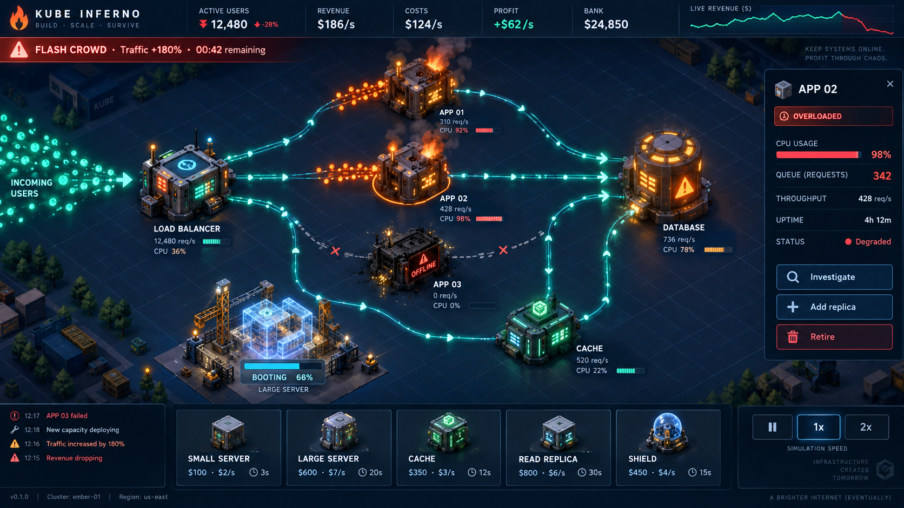

# Plan 006 — Kube Inferno

Status: standalone game slice implemented for feedback, 2026-10-03. Public Sprite
hardening and the broader simulation remain unfinished. This application plan
does not replace the concurrent active HtmlBox plan.

## Product and success criteria

Kube Inferno is a single-player infrastructure business game and a flagship CRC
example. Build a service, attract customers, earn money, and invest in capacity
and efficiency while surviving failures and changes in demand. Overloaded
machines burn; dead machines go dark and spit sparks. Traffic and money make the
consequences of each decision visible.

The reference-application question is whether CRC can deliver a compelling,
readable, graphics-led game through its existing public 2D surface. This plan
now includes an approved Sprite capability as an enabling runtime addition.
Existing Image behavior remains unchanged. Exact public types, playback semantics,
and ownership contracts must be specified before production implementation.

Success: a new player can identify a bottleneck, deploy and connect relief,
observe recovery, then scale down during a downturn without needing Kubernetes
expertise. The player must have meaningful choices beyond buying the largest
server. Failure to communicate those choices is a reason to simplify the map or
rebalance the game before expanding scope.

## Visual direction

Use this image for composition, palette, machine character, and atmosphere.
Its incidental labels, metrics, and connections are illustrative, not a
simulation specification.

- Midnight navy grid, miniature isometric industrial machines, teal healthy
  traffic, amber pressure, orange fire, and red failures.
- Fixed-angle 2D sprites provide depth. CRC draws the graph, UI, dynamic lights,
  construction progress, particles, fire, smoke, sparks, and selection states.
- A large central map, compact top business HUD, bottom draggable build tray,
  and contextual right inspector. Event messages remain secondary to the map.
- Sort machine artwork by ground position; draw connections beneath machines,
  effects above their owners, and HUD in screen coordinates. Keep ports and
  labels unobscured. Pan and zoom the map independently of the HUD.
- Prepare consistent transparent machine assets with shared scale, lighting,
  anchors, footprints, and port positions. The reference screenshot is not a
  sprite sheet. Generate/export assets separately during implementation.
- Healthy, broken, and construction appearances share silhouettes. Small fire
  and spark systems are attached to machines; avoid full-screen effect clutter.
- Labels, shapes, status icons, and metrics complement color. Include reduced
  effects and keyboard alternatives to dragging and connection gestures.

## Locked game loop and economy

Attract users → complete useful requests → earn revenue → buy capacity or
improvements → sustain more users → survive incidents and demand changes.

Always show active users, revenue/sec, operating costs/sec, profit/sec, and bank
balance. Show peak active users and peak bank balance in the run summary and
records. Active users are legitimate customers, never attack requests.

The deterministic model tracks potential demand, active customers, service
quality, reputation, queues, and cash. Revenue is proportional to active users
at healthy service, reduced by the fraction of successful monetizable activity.
Request rate is a separate quantity: retries and attacks consume capacity without
creating users or extra revenue. Book revenue once at successful transaction
completion; a retry cannot duplicate a sale.

Latency and failures reduce sales immediately. Sustained poor service increases
customer departures and damages reputation. Quality recovery is faster than
reputation recovery. Demand changes can occur independently of service quality.

All prices, request costs, time constants, and incident magnitudes are versioned
scenario tuning, not claims about real infrastructure prices or performance.
The inspector explains the cause of overload and the expected effect of an
investment; avoid an opaque composite health number as the only explanation.

Purchases require cash and charge upfront once on accepted placement. Preview
the price, running cost, build time, and projected profit before committing.
Provisioning machines incur their advertised operating cost during construction;
workload replicas begin their listed cost when starting. Every card states its
billing rule. Invalid placement costs nothing. Cancelling unfinished construction
returns a displayed unspent fraction; completed assets have no resale refund.
Retiring capacity stops its cost after drain/removal. These rules prevent free
capacity cycling and make build time a real investment decision.

At zero cash, warn and start a visible short insolvency grace period. Recovery
above zero clears it; sustained insolvency ends the run. Allow temporary negative
cash during that grace period, but no purchases. Final tuning must make recovery
possible through cost reductions. Initial cash does not vary on a ranked seed.

## Graph and Kubernetes-inspired model

Distinguish logical services, workload replicas, and physical node capacity:

- Graph components represent entry gateways, load balancers, application services,
  caches, and databases. Connections describe supported request dependencies.
- Service components display individual replica machines within a visual group.
  A replica exposes its assigned node and resource metrics when selected.
- Compute nodes supply scheduling capacity, visible as ground platforms/capacity
  groups. Adding replicas and adding nodes are separate purchases/actions.
- An inspector toggle can emphasize node placement without losing the service
  graph. Do not require wiring individual replicas: service traffic automatically
  distributes among ready replicas.
- Start with typed ports and directed, validated routes. Reject unsupported
  connections and dependency cycles with a clear reason. Retries are workload
  behavior, not graph cycles. Show routes missing a required dependency.
- A cache is an optional read path used by its connected application; cache hits
  bypass database reads, misses use the database, and writes still reach it.
  A read replica adds read capacity only. Both need explicit model semantics.

Use a documented subset of real Kubernetes manifest fields to define bundled
scenarios: Deployments, Services, resource requests/limits, readiness/startup
timing, and optional HPA settings. A node snapshot supplies allocatable capacity.
Validate supported fields and report unsupported behavior instead of implying
full Kubernetes emulation. Default gameplay needs no YAML authoring.

Scheduling fits requests against allocatable capacity. CPU constraints cause
throttling; memory exhaustion can cause container termination. Readiness gates
traffic admission. Pod failures and node failures have different blast radii.
Autoscaling has observation and startup delays. Fire communicates sustained
pressure; CPU overload alone does not randomly destroy hardware.

Manifests do not supply service call graphs, workload cost, or business behavior.
A separate workload recipe defines request mix, downstream calls, concurrency,
queues, timeout/retry policies, memory use, warmup, and revenue assumptions.
The standard Kubernetes resource Metrics API supplies CPU/memory, not the full
traffic/latency model. Telemetry import and calibration are later extensions.

Source references for realism:

- [Resource management](https://kubernetes.io/docs/concepts/configuration/manage-resources-containers/)
- [Horizontal autoscaling](https://kubernetes.io/docs/concepts/workloads/autoscaling/horizontal-pod-autoscale/)
- [Resource metrics pipeline](https://kubernetes.io/docs/tasks/debug/debug-cluster/resource-metrics-pipeline/)

## Interaction and build choices

Drag from the build tray, preview placement and costs, drop to purchase, then
connect compatible ports. Permit pre-wiring construction; traffic begins only
when the component is ready. Provide select/place and select-port alternatives.
Click components to inspect, investigate, add replicas, retire, or remove.
Existing connections can be rerouted or deleted with the consequences visible.

Graceful retirement stops new work, drains with a bounded timeout, then removes
capacity. Emergency termination is immediate and can fail in-flight requests.
Dead machines remain visible with intermittent sparks until replaced or removed.
Restartable workloads may recover automatically; failed nodes need replacement.

Initial catalog, with all numerical balancing deferred to playtesting:

| Purchase              | Advantage                                | Tradeoff                                        |
| --------------------- | ---------------------------------------- | ----------------------------------------------- |
| Small compute node    | Quick emergency capacity                 | Higher cost per capacity unit                   |
| Large compute node    | Efficient at sustained demand            | Longer build, larger failure impact             |
| App replica           | Adds service concurrency                 | Requires schedulable capacity; startup delay    |
| Load balancer         | Distributes traffic over ready replicas  | Running cost and finite capacity                |
| Cache                 | Removes repeated database reads          | Warmup, memory cost, workload-dependent benefit |
| Database read replica | More read throughput                     | Synchronization delay; no write relief          |
| Protection gateway    | Rejects a share of malicious traffic     | Running cost, finite filtering capacity         |
| Investigation         | Reveals a specific actionable bottleneck | Time and cash before any benefit                |

Investigations disclose concrete modeled issues, such as redundant queries or
excessive allocation. A discovered fix has an explicit price, duration, and
effect. Never charge for a random invisible percentage buff. Software work and
construction show remaining time; fixes take effect at completion.

## Readable live state

| State            | Visual                                    | Model consequence                      |
| ---------------- | ----------------------------------------- | -------------------------------------- |
| Healthy          | Steady lights and smooth teal streams     | Normal service                         |
| Strained         | Amber lights, growing visible queue       | Increasing latency                     |
| Overloaded       | Flames and smoke                          | Sustained pressure, timeouts and churn |
| Dead             | Dark chassis, irregular sparks            | No capacity; possible failover         |
| Building         | Translucent chassis and assembly progress | Purchased but unavailable              |
| Starting/warming | Sequential lights and progress            | Capacity ramps or waits for readiness  |

Traffic density reflects volume; particle transit time reflects modeled latency.
Aggregate particles represent batches, not individual requests. Cap visual counts
and use a visible legend for density/speed saturation at large scales. Failures
flash/break apart; successful monetizable activity triggers restrained money
pulses. Render queues separately from requests in transit.

Pressure states use thresholds with hysteresis so flames do not flicker on/off
at one boundary. Sparks are irregular but seeded for repeatable captures.
Visual effect randomness never changes simulation outcomes.

## Events, progression, and records

Ship an endless growth mode with a guided opening and seeded incident scheduling.
Players unlock complexity through business milestones; provide the reason for
each new tool. Add fixed-seed challenges once the basic economy is enjoyable.

Events: flash crowd, random node death, provider capacity loss, bad release,
DDoS, security breach, economic downturn, and an announced major-customer launch.
Introduce node failure, demand surge, and downturn first. Security events are
abstract operational incidents with containment/remediation actions; they do not
require offensive tooling or imply that a gateway prevents every breach.

Events have telegraphs where appropriate, a bounded duration or resolution
condition, and a meaningful response. Cap overlapping crises early. A downturn
reduces legitimate demand and rewards retiring excess infrastructure. Attacks
increase non-paying demand and reward filtering rather than blind expansion.

Persist peak concurrent legitimate users and peak bank balance locally with
seed, scenario/balance version, mode, and run duration. Keep sandbox records
separate from challenge records. No online leaderboard in the initial release.
Pause and simulation speed controls do not alter deterministic outcomes.

## Approved Sprite capability

The user approved a Sprite component whose underlying model supports arbitrary
frame rectangles. A uniform grid is a convenience, never a required sheet layout.
Mixed row sizes, different frame dimensions, and irregular packed positions must
be representable without rearranging the source artwork.

Separate these responsibilities:

- A reusable asset description identifies source images and named frame records.
  Each frame specifies its source rectangle, original untrimmed logical size,
  and trim placement within that size. A stable anchor keeps the sprite planted.
- Animation sequences refer explicitly to frame names and durations; source image
  order and row layout have no implied animation meaning.
- Sprite instances select and render frames with independent playback state.
  Frame changes preserve the declared logical box instead of stretching each
  cropped frame to fill it. Existing CRC style transforms remain authoritative.
- Grid helpers produce these same records using cell sizes, margins, and spacing.
  Explicit records remain the escape hatch for hand-made sheets.
- Format-specific adapters translate supported Aseprite and TexturePacker JSON
  exports into the normalized description. Importers must identify their supported
  variants and reject unsupported packing features rather than misrender them.
- Optional per-frame art corrections are distinct from imported trim offsets.
  Their coordinate space and composition order must be explicit in the contract.

A definition helper is optional. It earns its place only through concrete
validation/normalization and useful animation-name typing. It must not quietly
create timers, start loading, or own mutable playback state.

Sprite sheets come first. Animated GIF decoding may later supply frames to the
same playback mechanism, but is not a dependency for the game. Ordinary Canvas
drawing of HTML image elements does not provide GIF frame playback. Do not promise
automatic animated Image support as part of this slice.

Before implementation, settle frame coordinate units, anchor behavior, rotated
packing support, logical sizing/measurement, hit geometry, asset sharing and
release, source replacement, load errors, playback control ownership, looping,
completion, pause/speed behavior, and Layer invalidation. Read existing drawing,
animation, scheduling, style, and resource contracts and reuse their semantics.
Do not introduce a second scheduler or silently expand Image semantics.

## Application architecture and boundaries

- Implement under `games/kube-inferno` using public `@crc/core` entries and JSX.
  The user requires a completely standalone page with no Studio shell or other
  navigation. Use a dedicated Vite entry and production build.
- Separate a pure, fixed-step simulation and serializable commands from CRC
  rendering and browser persistence. Use seeded event RNG, stable entity IDs,
  and simulation-time build clocks. Queue mutations at tick boundaries.
- Advance from CRC's supported frame/animation lifecycle. No second animation
  loop, private scheduler imports, or React dependency. Inspect current animation,
  particle, drawing, event, and ownership contracts before implementation.
- Signals publish committed view state. Component drawing does not mutate the
  model. Use explicit Layers where they help cache stable map artwork; keep
  dynamic traffic/effects bounded and separate from static content.
- Model requests with bounded cohorts/aggregates. High user counts must not
  allocate an entity or particle for every customer, request, or retry.
- Keep asset ownership, playback, listeners, and persistence cleanup explicit.
  Hidden-tab behavior pauses the local game instead of simulating an unbounded
  offline incident backlog on return.
- Use the same scenario/model for manual play and headless public-API checks.
  Deterministic test fixtures remain separate from the learning presentation.

No live cluster credentials/actions, full Kubernetes emulator, multiplayer,
3D renderer, imported incident replay, mobile-first layout, or core engine
capabilities beyond the approved Sprite addition are required. Optional audio and extended map sizes follow evidence
from the first playable version.

## Delivery sequence

The following is the implementation queue for this project when activated.
Each playable milestone gets hands-on feedback before broadening or hardening.

| Step                                    | State              | Completion bar                                                          |
| --------------------------------------- | ------------------ | ----------------------------------------------------------------------- |
| Sprite enabling slice                   | Next               | Irregular frames animate with stable placement and independent playback |
| First playable economy and visual slice | Ready for feedback | Runnable loop and focused checks; exact standalone URL                  |
| Graph building and meaningful tradeoffs | Queued             | Player constructs and improves a working service                        |
| Events, growth, and records             | Queued             | Complete repeatable run with saved scores                               |
| Hardening and public example delivery   | Queued             | Accepted behavior verified and documented                               |

### [NEXT] Sprite enabling slice

1. Inspect the current runtime and settle the narrow public contract described
   above. Record actual proposed types and observable semantics, not placeholder
   helper names. Preserve unrelated working-tree changes.
2. Add a focused failing public-API scenario test with irregularly positioned,
   differently sized trimmed frames. Assert stable ground placement and logical
   dimensions when selecting frames before adding timed playback.
3. Implement the minimum Sprite path and an explicit irregular sheet description.
   Then add a focused playback test and scheduled playback through the existing
   CRC lifecycle, showing two instances of the same asset at independent phases.
4. Expose a small standalone sprite lesson: animated machine, play/pause controls,
   frame inspection, and a load control that changes machine activity. Include
   deterministic headless driving of that exact scenario.
5. Give the user the exact running URL and what to inspect. Seek feedback before
   expanding the importer matrix, GIF support, or game catalog. A grid helper and
   one real exported atlas can follow as small independently testable additions.

Done when focused tests and manual browser checks show stable geometry,
independent playback, correct Layer updates, and teardown through public entries.
This is an enabling **slice ready for feedback**, not a claim that the entire
Sprite capability or game is feature complete. Before Sprite is called complete,
verify declarations, packed consumers, source/built modes, editor declarations,
and documented ownership in accordance with repository requirements.

### [IN PROGRESS] First playable economy and visual slice

1. Read relevant current public contracts and catalog conventions. Add one focused
   failing public-scenario test: rising demand overloads the app; purchasing and
   connecting delayed capacity relieves it and changes cash/profit correctly.
2. Deliver a small gateway → app → database topology across visible capacity,
   with one draggable purchase, typed connection ports, build time, and inspection.
3. Match the reference with a small coherent sprite set, HUD, traffic particles,
   load-responsive fire, one scripted dead/sparking machine, and construction.
4. Implement customers, successful revenue, running costs, cash, and deterministic
   surge/recovery/downturn beats. Offer retirement so the downturn is playable.
5. Run the focused test and a browser check against the same scenario. Share the
   exact running standalone URL and instructions: observe fire, add capacity, connect
   it, wait for readiness, see recovery, then retire excess capacity.

Done when the public example is playable, the focused checks pass, and the user
can judge visual clarity and the business loop. This is **slice ready for
feedback**, not feature complete. If artwork or graph readability is poor, refine
this slice before adding the full catalog or incident roster.

### [TODO] Graph building and meaningful tradeoffs

Incorporate first-slice feedback. Add distinct node/replica capacity behavior,
small/large hardware, cache, read replicas, typed routing, investigation/fixes,
and cancellation/drain economics. Provide bundled manifests plus workload
recipes and validate the supported subset. Use focused tests for each new
observable contract before implementation.

Done when at least two different investments can solve a scenario, and the player
can explain their timing/cost tradeoff from the interface. Share the updated URL
for playtesting before expanding events.

### [TODO] Events, growth, and records

Add event scheduling, the remaining incident types, protection, reputation,
milestone progression, bankruptcy, pause/speed controls, local records, and
fixed-seed challenge configuration. Keep a compact event log and clear incident
objectives. Tune after observing real play rather than assuming sample prices
are balanced.

Done when a full run can grow, recover, downsize, end, and record valid peaks;
the same seed and command timeline produce the same outcomes.

### [TODO] Hardening and public example delivery

After experiential acceptance, expand coverage for invalid connections,
insufficient cash, cancellation, pending replicas, removal with in-flight work,
readiness, retry amplification, node/pod failure distinctions, cache warmup,
read/write separation, incident overlap, hidden tabs, restarts, and persistence.

Assert semantic states, accounting, routing, geometry, and deterministic replay
before visual evidence. Capture seeded healthy, overloaded, dead, and building
states; inspect baseline differences rather than replacing them blindly. Measure
bounded particles/cohorts and exact lifecycle cleanup. Verify keyboard operation,
reduced effects, pan/zoom targeting, and readable HUD layout.

Document controls, model simplifications, asset provenance, scenario inputs, and
manual observations. Add a dated field note. Verify source and built standalone page,
catalog/public boundary checks, and proportional repository gates. Run the final
aggregate `corepack pnpm@11.21.0 trust` on Node 24.15+ / Node 24 LTS with pnpm
11.21.0 and Playwright Chromium, reporting fresh results and unrelated blockers.

Done when accepted behavior is hardened, reviewed, documented, and verified:
**feature complete**. No runtime performance claim is established by this plan.

## Decision and session log

- 2026-10-03: User required a completely separate standalone page with no other
  navigation. Implemented `games/kube-inferno`, served at
  `http://127.0.0.1:5190/`, with an independent build. The map uses CRC and generated
  atlas art; native controls surround it. Purchase, wiring, construction, overload,
  revenue, investigation, retirement, scripted events, pause/speed, and local peak
  records are playable. Sprite is application-local; public animation/atlas APIs
  are not yet shipped. The first slice intentionally bundles node/workload
  capacity and defers full manifest modeling and incident breadth until feedback.
  See [slice verification](../../games/kube-inferno/VERIFICATION.md).

- 2026-10-02: User approved arbitrary frame rectangles, original sizes/trim
  offsets, stable anchors, explicit sequences, and convenience grid/import paths.
  Added the Sprite enabling slice before the game loop. Sprite sheets are the
  first source; GIF decoding remains a later optional adapter. Public API spelling
  is not finalized and no Sprite implementation is claimed.

- 2026-10-02: Consolidated the user's business-growth game, demand/revenue model,
  peak-user and peak-bank records, drag/connect/remove interaction, differentiated
  purchases/build times, random crises, burning overload, and sparking failures.
- 2026-10-02: Preserved the approved image in this plan's asset directory. Chose
  2D isometric art plus CRC effects instead of requiring Three.js.
- 2026-10-02: Defined service graph versus node/replica semantics, explicit
  workload recipes, bounded traffic visualization, and feedback-first delivery.
  Economy details are implementation defaults subject to gameplay feedback.
- 2026-10-02: Planning only. No production code changed or runtime tests run.
  Concurrent working-tree changes and the active project pointer were preserved.
