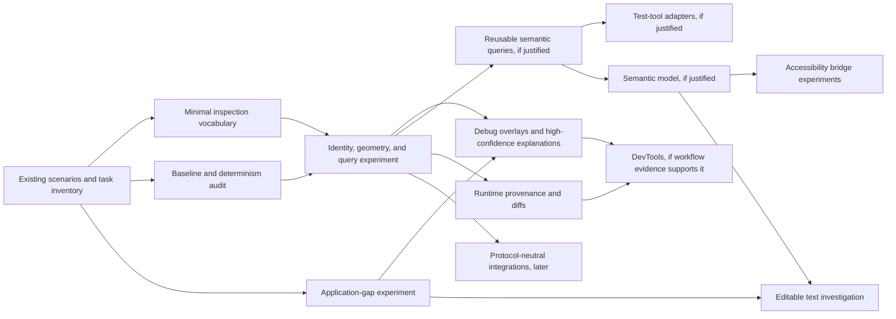

# CRC product strategy and future opportunities

- **Status:** Directional guidance and food for thought; not an implementation
  specification, active plan, or feature commitment
- **Version:** 0.1
- **Last reviewed:** 2026-09-09
- **Review trigger:** Material product evidence, an approved new project plan,
  or completion of work that changes an assumption recorded here

## Purpose and authority

This document records product hypotheses, promising opportunities, cautions,
and experiments that may inform future CRC work. It critically revises an
earlier improvement proposal rather than accepting that proposal as a roadmap.
Its purpose is to keep useful ideas discoverable without silently turning them
into commitments.

This document is non-normative:

- Current public code, executable tests, and implemented contracts define
  shipped behavior.
- The [project-plan index](../project-plans/README.md) identifies approved work
  and the active execution queue.
- The [accepted and deferred follow-ups](../follow-ups.md) record concrete
  measured triggers and current product deferrals.
- No idea in this document authorizes implementation, a public API, or a change
  to an existing contract. That requires the normal design and project-plan
  process.

When this document conflicts with shipped behavior or an approved plan, those
sources win. Update this document when the conflict represents a changed
assumption rather than rewriting historical plans or field notes.

## Related design inputs

- [Requirement-level verification ledger](./agent-verification-ledger.json):
  every inventory ID, explicit audit status, evidence scope and remaining work.
  Accounting coverage is not an implementation completion percentage.
- [Agent verification continuation audit](./agent-verification-progress.md)
  (2026-09-29): complete requirement accounting, current integration state and
  the next executable verification slice. No blanket completion claims.

- [Responsive style queries](./responsive-style-queries.md) (2026-09-28):
  exploratory general styling ideas prompted by the visualization mobile gap;
  not part of visualization implementation or an approved API.

- [Agent verification capability inventory](./agent-verification-inventory.md)
  (2026-09-28): an agent-first inventory of observation, control, assertion,
  diagnosis and evidence needs for complex CRC applications. It includes
  ownership boundaries, conditional visualization/renderer facets, exclusions
  and a consistency review. It is design input, not an implementation commitment.

## Executive view

The strongest working thesis is:

> **CRC should be an application-oriented Canvas 2D runtime that is unusually
> observable, deterministic, and debuggable. This should benefit human
> developers first-class; coding agents are an important beneficiary and a
> demanding test of the design.**

This framing preserves the useful human/agent development loop without defining
CRC primarily around current agent tooling. Inspection, diagnostics, testing,
accessibility, DevTools, support, and automated repair could share foundations
if those foundations prove useful.

The original proposal is directionally strong, but it reaches implementation
conclusions too quickly. A better approach would:

1. Treat any inspection model as a deliberately designed boundary, not a dump
   of runtime internals.
2. Use CRC's existing learning scenarios, deterministic laboratories, browser
   drivers, and structural evidence as the starting point for representative
   workloads and baselines.
3. Validate application-enabling capabilities such as scrolling or remaining
   text gaps alongside observability experiments, rather than making all
   product work wait for a large tooling platform.
4. Build protocol-neutral facts and queries before matcher catalogs, full
   DevTools, or agent-specific integrations.
5. Defer portable serialization, remote rendering, and visual-editor
   architecture until a concrete consumer makes their requirements clear.

## Thesis, principles, and possible work

These categories must remain separate. A thesis guides exploration; a principle
constrains design; a candidate invites validation; only an approved plan commits
capacity.

### Product thesis to validate

CRC may occupy a useful category between low-level Canvas drawing libraries and
DOM application frameworks: a functional runtime for interactive,
layout-oriented Canvas 2D applications such as dashboards, diagrams, editors,
inspectors, and timelines.

Observability may be a meaningful differentiator in that category. The
hypothesis is not merely that CRC can expose a tree, but that developers can
answer high-value questions faster:

- What does CRC believe exists?
- Where did it place and paint it?
- Why did it make that decision?
- Why did an interaction resolve to this target?
- What changed, and can the result be reproduced?

This is promising, not proven positioning. Validate it through user tasks and
representative applications before presenting it as a product promise.

### Durable design principles

- **Human-first, automation-capable.** Human workflows must remain coherent
  without an agent. Machine-readable output should follow from clear runtime
  concepts rather than an agent-specific architecture.
- **Observable by design.** Important layout, rendering, focus, and interaction
  decisions should be inspectable without decoding pixels when practical.
- **Deterministic where practical.** Equivalent inputs and controlled
  environments should produce reproducible logical results.
- **Application-oriented.** Prioritize capabilities that unlock complete
  applications over breadth for its own sake.
- **Typed and explicit.** Prefer constrained contracts, actionable validation,
  and visible failure over silent ambiguity.
- **Stable boundaries, evolvable internals.** Tooling contracts must not
  accidentally freeze private immediate-mode runtime structures.
- **Layered tooling.** A small instrumentation layer could support overlays,
  tests, DevTools, and adapters without placing every tool in core.
- **Measured scope.** CRC should state the workloads it serves well and avoid
  graphics-engine parity as a goal.

### Candidate validation work, not commitments

These are plausible early investigations if a future planning cycle selects
this direction:

1. Inventory representative CRC debugging tasks against existing learning and
   laboratory scenarios.
2. Define a minimal inspection vocabulary that distinguishes lifecycle
   identity, logical structure, layout allocation, paint records, and event
   targets.
3. Prototype read-only inspection for a narrow set of layout, paint, clip, and
   interaction questions.
4. Test a small number of debug overlays or explanations against seeded bugs.
5. Explore one application-enabling gap, such as a narrow scrolling slice or
   text truncation/ellipsis, in the same proving environment.
6. Record which existing deterministic evidence can support logical snapshots
   and which platform-owned behavior needs metadata or tolerances.

### Working initiative register

This register summarizes strategic state; it is not a task board. `Explore`
means “gather evidence,” and `Deferred` means the current contracts intentionally
exclude the capability. `Ready for plan`, `Active`, and `Shipped` should be used
only when repository evidence supports them.

| Initiative                                       | State    | Next evidence needed                                                                                                 | Execution link                                                  |
| ------------------------------------------------ | -------- | -------------------------------------------------------------------------------------------------------------------- | --------------------------------------------------------------- |
| Representative debugging-task inventory          | Explore  | Identify a small set of recurring layout, paint, and interaction questions in existing scenarios                     | —                                                               |
| Minimal inspection vocabulary                    | Explore  | Show that one vocabulary can answer those questions without mirroring runtime internals                              | —                                                               |
| Runtime explanations and debug overlays          | Explore  | Seeded-bug study using narrow instrumentation                                                                        | —                                                               |
| Public or protocol-neutral semantic queries      | Explore  | Identify consumers beyond existing internal semantic/geometry assertions                                             | —                                                               |
| Scrolling                                        | Deferred | Reference application that demonstrates the smallest useful public abstraction                                       | [Current deferral](../follow-ups.md#explicit-product-deferrals) |
| Display-text gaps                                | Explore  | Inventory unmet truncation, ellipsis, baseline, and metric-predictability needs beyond shipped wrapping/fit/clipping | —                                                               |
| Semantic model and accessibility bridge          | Deferred | Concrete assistive-technology scenarios and ownership model                                                          | [Current deferral](../follow-ups.md#explicit-product-deferrals) |
| Editable text adapter                            | Deferred | Product scenario plus focus, selection, IME, clipboard, and accessibility contract                                   | [Current deferral](../follow-ups.md#explicit-product-deferrals) |
| Serialization and protocol-specific integrations | Deferred | Named consumer with requirements that cannot be met by a general query layer                                         | —                                                               |

## Critical assessment of the original recommendations

### High-value ideas

| Recommendation                                                  | Assessment                                                                | Revision                                                                                                                                                                 |
| --------------------------------------------------------------- | ------------------------------------------------------------------------- | ------------------------------------------------------------------------------------------------------------------------------------------------------------------------ |
| Logical inspection                                              | Potentially foundational and differentiating if it answers real questions | Begin with a small, explicitly versioned vocabulary; do not expose a giant internal snapshot                                                                             |
| Logical identity                                                | Necessary for diffs, selection, traces, tests, and tooling                | Preserve CRC's shipped lifecycle identity rules; separately define whether a tooling identity exists and what lifetime it has                                            |
| Resolved layout and geometry visibility                         | Directly valuable for ordinary debugging                                  | Include coordinate spaces, clip ancestry, and provenance; distinguish specified, normalized, measured, allocated, and painted facts                                      |
| Excellent errors                                                | Broad value with relatively low conceptual risk                           | Treat as a continuous quality bar and improve errors from observed failures                                                                                              |
| Debug overlays                                                  | Fast human value and a useful validation surface                          | Try narrow overlays before committing to a complete inspector                                                                                                            |
| Representative benchmarks                                       | Essential for architectural decisions and honest positioning              | Extend CRC's existing structural/performance evidence around representative tasks before investing in competitor scorekeeping                                            |
| Scrolling                                                       | A meaningful application capability and architectural stress test         | Keep deferred until a focused design names the smallest useful slice and resolves clipping, events, focus, and navigation                                                |
| Text truncation, ellipsis, baselines, and metric predictability | Possible application-level gaps                                           | Start from CRC's shipped wrapping, fit, clipping, multiline measurement, and platform-owned font behavior; do not reopen already-settled text contracts without evidence |
| Strong types and closed schemas                                 | Supports humans, tools, and generated code                                | Preserve explicit extension points where concrete application needs justify them                                                                                         |

### High-value ideas with dependencies

| Recommendation                         | Dependency or caution                                                                                                                                                  |
| -------------------------------------- | ---------------------------------------------------------------------------------------------------------------------------------------------------------------------- |
| Machine-readable diagnostics           | Requires reliable facts, provenance, severity rules, and a way to prevent warning noise                                                                                |
| Public semantic queries and assertions | Must justify a public surface beyond CRC's existing internal semantic/geometry assertions and exact public-API scenario evidence                                       |
| Runtime explanations                   | Requires scoped instrumentation of measurement, layout, invalidation, hit testing, and focus resolution                                                                |
| Scene/layout DevTools                  | Requires an inspection protocol, selection semantics, and low-overhead snapshots or subscriptions                                                                      |
| Lightweight semantic metadata          | Requires concrete accessibility and testing use cases so CRC does not invent an incomplete pseudo-DOM                                                                  |
| Accessibility bridge                   | Requires semantics, focus/keyboard behavior, ownership rules, and testing with actual assistive technologies; companion DOM alone does not guarantee accessibility     |
| Editable text                          | Requires a coherent adapter around CRC's existing editing/composition and clipboard event facades plus caret, selection geometry, focus, IME, and platform integration |

### Questionable ideas or framing

| Original idea                                 | Concern                                                                                                                                      | Better framing                                                                                                                               |
| --------------------------------------------- | -------------------------------------------------------------------------------------------------------------------------------------------- | -------------------------------------------------------------------------------------------------------------------------------------------- |
| `controller.inspect()` returns everything     | A convenient dump can leak private structure, become expensive, expose sensitive text/props, and create an accidental compatibility contract | Explore a capability-versioned inspection boundary with filters, redaction, and explicit stability levels                                    |
| “Agent feedback loop” as a roadmap pillar     | It over-specializes general developer infrastructure and risks optimizing for transient tool conventions                                     | Build a developer feedback loop that is structured enough for automation                                                                     |
| Diagnostics as a large warning catalog        | Static warning lists can become noisy, costly, or misleading                                                                                 | Start with a few high-confidence diagnoses linked to evidence and remediation                                                                |
| Jest-style matchers as the test foundation    | Matchers prematurely bind the model to one test runner and naming scheme                                                                     | First determine whether reusable queries are needed; keep adapters thin                                                                      |
| Comparative benchmarks against many libraries | Cross-library tests can reward unnatural implementations and consume substantial maintenance                                                 | First establish CRC budgets and regressions on representative applications; compare externally only where workloads are genuinely equivalent |
| “Application runtime” as settled positioning  | The phrase may be accurate but too abstract for users                                                                                        | Treat it as an internal category hypothesis and test the language with actual users                                                          |
| Strict rejection everywhere                   | Excessive closedness can block legitimate custom rendering and extension                                                                     | Be strict at stable boundaries while retaining deliberate, contained extension points such as `definePrimitive`                              |

### Premature or deferred ideas

- **Serializable declarative CRC format.** This risks freezing component,
  registry, style, and security models before a concrete persistence use case
  exists.
- **MCP-specific tools.** Any future agent protocol should sit over a
  protocol-neutral inspection/query surface.
- **Remote rendering.** Its transport, determinism, asset, font, input, and
  security requirements need an actual use case.
- **Visual editor integration.** Editing semantics are broader than inspection
  semantics and should not shape core prematurely.
- **Large reusable component library.** This becomes useful only after common
  application patterns and composition boundaries stabilize.
- **Broad IDE integration.** Defer until source mapping and inspection workflows
  prove valuable manually.
- **Full DevTools product.** Start with narrow overlays or textual inspection;
  earn a larger interface through observed debugging needs.

### Scope cautions

CRC should not pursue particle or physics systems, a massive primitive catalog,
complete CSS/SVG compatibility, a public mutable scene graph, or parity features
whose main purpose is competitive checklists. Broad renderer replacement should
also require compelling evidence. This does not pre-judge focused acceleration
experiments or approved isolated-rendering designs; the relevant question is
whether they improve CRC's chosen application workloads without compromising
its contracts.

## Missing foundations and questions

The original proposal names many outputs but omits or understates several
foundations needed to make them trustworthy.

### 1. Representative applications and developer tasks

Start with CRC's existing learning scenarios and deterministic laboratories.
Select a small set that collectively exercises:

- nested layout, text, clipping, filters, and frequent updates;
- transforms, selection, hit testing, and large element counts;
- focus, keyboard navigation, dense interaction, and eventual scrolling needs.

The unit of validation should be a developer task—“explain why this item is
clipped”—not merely whether a field appears in a snapshot.

### 2. Determinism and reproducibility

CRC already prefers deterministic structural and ownership evidence. A tooling
proposal must additionally document nondeterminism from fonts, device pixel
ratio, clocks, platform text metrics, decoded assets, and browser capabilities.
Decide which logical outputs can be stabilized and which require environmental
metadata or tolerances.

### 3. Explanatory provenance

A static scene answers “what.” Hard bugs often require “why.” CRC could
experiment with associating a resolved fact with selected causes:

- supplied style, normalization, or default;
- parent constraint and available space;
- pure measurement result;
- Grid/Flex allocation decision;
- world transform and clip ancestry;
- invalidation/update cause;
- hit-test candidates and winning target;
- focus eligibility and navigation decision.

This must be sampled and scoped. Recording every decision continuously could
change the performance and memory behavior being observed.

### 4. Automated execution boundary

CRC already drives public scenarios headlessly and asserts semantic state and
geometry. What it lacks is a promised public input-injection or general tooling
adapter. Before creating one, identify consumers that cannot use the existing
test laboratory and define font/asset readiness, controlled time and animation,
input synthesis, and ownership boundaries.

### 5. Contract versioning, cost, and privacy

Inspection may expose text, labels, event capabilities, source paths, and
application state. Any design needs:

- schema and capability versioning;
- production/development availability rules;
- redaction and opt-out behavior;
- performance and memory budgets;
- snapshot size limits and subtree queries;
- an explicit distinction between stable and diagnostic-only fields.

### 6. Extension and ownership boundaries

Clarify how `definePrimitive`, ordinary composite components, layout parents,
and first-class primitives participate in inspection, semantics, diagnostics,
and accessibility. Tooling that understands only built-ins will fail on the
applications most likely to need it.

### 7. Adoption and migration

CRC's lifecycle identity is currently derived from parent path,
component-function identity, and optional sibling key; keys do not preserve
identity across parents. Decide whether tooling observes that identity, creates
a separate identity, or needs neither. Also decide how inspection behaves when
source metadata or semantic annotations are unavailable.

## Possible validation sequence

This is a dependency sketch, not a schedule or set of approved phases. Tracks
may move independently if evidence supports them.

### Stage 0 — Define the proving ground

**Question:** What work would make the opportunity testable?

- Select reference scenarios and a small set of debugging tasks.
- Capture relevant correctness, performance, and memory baselines.
- Inventory shipped runtime concepts that could support identity and
  inspection.
- List determinism hazards and reusable existing fixtures.

**Evidence to advance:** Reproducible workloads and ten or fewer high-value
questions an inspection experiment must answer.

### Stage 1 — Test a minimum observability spine

**Question:** Can CRC reveal useful logical state without retaining drawing
commands or freezing internals?

- Define the relationship among lifecycle identity, logical components,
  element descriptors, layout allocation, paint-ledger entries, and event
  targets.
- Prototype filtered inspection for hierarchy, bounds, paint order, clipping,
  and event geometry.
- Prefer subtree lookup and point/element queries over mandatory full snapshots.
- Try two or three overlays, such as layout boxes, clips, and hit targets.

**Evidence to advance:** Developers complete selected debugging tasks materially
faster; development-mode overhead is bounded; private structures have not become
public contract accidentally.

### Parallel study — Validate an application gap

**Question:** Does a missing application capability supply a useful stress test
and unlock a real use case?

- Candidate A: a deliberately narrow scrolling experiment, beginning with one
  axis and one container before nested or virtualized behavior.
- Candidate B: remaining display-text behavior such as truncation, ellipsis,
  baseline control, or more predictable metric handling.
- Use any inspection prototype to debug transforms, clips, focus, and hit
  testing in the experiment.

**Evidence to advance:** A reference application becomes meaningfully more
practical and exposes concrete requirements for the observability model.

### Stage 2 — Test queries, diagnostics, and explanations

**Question:** Can raw observable facts become reusable developer capabilities?

- Explore protocol-neutral queries for hierarchy, text, geometry, visibility,
  focus, interaction, and optional semantic metadata.
- Add only high-confidence diagnostics with codes, evidence, location, and
  likely remediation.
- Prototype causal traces for one layout question and one interaction question.
- Explore logical snapshot diffs with explicit tolerance and nondeterminism
  rules.

**Evidence to advance:** A person and a simple automated client can complete the
loop `write → run → query → explain → change → verify` using the same general
facts. Measure task completion and diagnostic precision, not API surface area.

### Stage 3 — Test semantics and focused tooling

**Question:** Do concrete consumers justify adding meaning beyond graphical and
interaction structure?

- Derive a minimum role/state model from accessibility and test scenarios.
- Validate custom-component participation and fallback behavior.
- Consider a compact textual/tree inspector or DevTools panel only if overlays
  and queries leave recurring workflow gaps.
- Test any accessibility bridge with real assistive technologies and keyboard
  workflows.

**Evidence to advance:** The semantic model supports selected workflows without
pretending to reproduce the DOM or all of ARIA, and an accessibility approach
demonstrates value beyond a synchronized hidden tree.

### Horizon — Broader capabilities and integrations

Only after the runtime and tooling boundaries prove useful and stable should CRC
consider serialized descriptions, remote rendering, visual editors, broad IDE
integrations, or protocol-specific agent tools. Each should begin with a named
consumer and an experiment, not a generalized platform build.

## Possible inspection boundary

Do not commit immediately to one monolithic `controller.inspect()` return
value. A safer conceptual boundary to investigate has four layers:

1. **Canonical facts:** identity or correlation handles, logical type,
   hierarchy, bounds, coordinate space, visibility, paint order, clip
   relationships, and focus/interaction eligibility.
2. **Optional facets:** source metadata, specified/normalized/resolved styles,
   text, event capabilities, semantic metadata, and measurement details.
3. **Queries:** locate by handle or semantic criteria; inspect a subtree; map a
   canvas point to candidates; map an element to rendered geometry.
4. **Explanations and diagnostics:** derived, potentially expensive answers
   with explicit evidence and stability expectations.

The API shape remains open. One method with options, a session object, or a
protocol adapter should be compared only after experiments measure snapshot
size, query frequency, instrumentation cost, and compatibility with CRC's
immediate-mode traversal.

## Experiments and decision criteria

| Experiment                     | Question                                                        | Smallest credible test                                              | Success signal                                                         | Failure or redirect signal                                        |
| ------------------------------ | --------------------------------------------------------------- | ------------------------------------------------------------------- | ---------------------------------------------------------------------- | ----------------------------------------------------------------- |
| Debug-task comparison          | Does logical inspection save meaningful time?                   | Reproduce 5–10 layout/interaction bugs with and without a prototype | Faster correct diagnoses and fewer screenshot-only guesses             | Fields accumulate but do not help users reach causes              |
| Inspection-boundary prototype  | Can a useful model avoid mirroring internals?                   | Implement canonical facts for one reference scenario                | Vocabulary survives a relevant internal refactor                       | Consumers require private nodes or implementation-specific fields |
| Instrumentation budget         | Is observability affordable?                                    | Measure disabled, enabled-idle, and active-query modes              | Negligible production cost and bounded development overhead            | Always-on bookkeeping materially changes target workloads         |
| Deterministic logical snapshot | Can logical output be reproduced?                               | Repeat runs across controlled and differing environments            | Stable core facts and documented environment-dependent fields          | Font, timing, or platform differences dominate the output         |
| Diagnostic precision           | Can CRC explain a few problems reliably?                        | Overflow, zero-area hit target, and clipped-away content            | Low false-positive rate and actionable evidence                        | Heuristics create noise or prescribe incorrect fixes              |
| Scrolling slice                | Does scrolling unlock a target application and fit CRC's model? | One-axis clipped container with pointer, wheel, and focus behavior  | Reference scenario becomes practical and transforms remain inspectable | Nested input/focus semantics require a different abstraction      |
| Semantic model                 | Can one small model serve tests and accessibility?              | Button, checkbox, list/tree item, and value-control scenarios       | Concepts work across consumers with clear fallbacks                    | Consumer needs conflict or recreate large DOM/ARIA semantics      |
| Automation client              | Is the surface generally machine-usable?                        | A small client diagnoses and verifies several seeded bugs           | Uses general queries with no CRC-internal knowledge                    | Requires bespoke prompts, screenshots, or protocol-specific hooks |

## Measures of progress

Avoid measuring success by feature count or inspection-field count. Possible
measures include:

- median time to diagnose selected layout and interaction failures;
- proportion of seeded failures correctly explained;
- false-positive rate for diagnostics;
- logical snapshot stability across repeat runs;
- runtime overhead with tooling disabled and enabled;
- snapshot/query size and latency at representative scales;
- regression detection quality;
- completion of representative applications without custom workarounds;
- usability for human developers and protocol-neutral automated clients.

Any competitor comparison should be subordinate to these measures. The goal is
to understand CRC's useful performance envelope, not manufacture universal
wins.

## Open questions

### Product and positioning

- Which application categories are already choosing CRC, and what jobs are they
  hiring it to do?
- Is “functional application runtime for Canvas 2D” immediately understandable
  to intended users?
- Is observability important enough to drive adoption, or mainly a retention
  and productivity advantage?
- Which missing capability blocks real applications most often: scrolling,
  remaining text behavior, editing, accessibility, performance, or something
  else?

### Identity and inspection

- Should tooling expose current lifecycle identity, a shorter-lived correlation
  handle, or an explicitly supplied application identity?
- Which structures are logical elements: component instances, element
  descriptors, layout boxes, paint records, semantic targets, or relationships
  among them?
- Which fields are stable public contract, versioned tooling contract, or
  best-effort debug data?
- Should inspection be snapshot-based, query-based, subscription-based, or a
  combination?
- How are custom primitives and composites represented without leaking private
  implementation details?
- What is the default redaction policy for text, source paths, props, and
  application data?

### Runtime explanations

- Which “why” questions are common enough to justify provenance storage?
- Can explanations be reconstructed on demand, or must decisions be recorded
  during layout and render?
- How will explanation mode avoid perturbing the behavior and performance it
  observes?
- What causal vocabulary can remain stable across algorithm changes?

### Testing and determinism

- Which logical facts can be exact across platforms, and which require
  tolerances?
- How should existing test-lab drivers relate to any public tooling adapter?
- What belongs in CRC core versus a testing or tooling package?
- How are fonts, images, animation clocks, device pixel ratio, and async assets
  controlled for repeatable tooling output?

### Semantics and accessibility

- Should semantics attach to logical components, event targets, rendered
  primitives, or explicit semantic nodes?
- How are ordering, grouping, dynamic announcements, focus, and keyboard
  interaction represented?
- When does a companion DOM improve accessibility, and where does it introduce
  conflicting focus or interaction behavior?
- How would the model be validated with assistive-technology users rather than
  inferred from automation needs?

### Application capabilities

- What is the smallest scrolling abstraction that does not preclude nested
  scrolling, virtualization, or accessibility later?
- Is editable text a core primitive, an adapter around a DOM control, or a
  higher-level package?
- Which additional text guarantees can CRC realistically make across
  platforms?

## Decision policy

An idea moves from this document toward a commitment only when it has:

1. a named user or reference-application problem;
2. evidence that current public capabilities do not already solve it;
3. a clear dependency position;
4. a smallest credible experiment;
5. success and stop criteria;
6. an approved owner and capacity allocation;
7. a statement of which public contracts, if any, it could create or change.

Prefer reversible experiments before stable APIs, protocol-neutral capabilities
before integrations, and concrete debugging tasks before schema breadth. Once
approved, move execution detail into a numbered project plan rather than using
this strategy as a task tracker.

## Decision log

| Date       | Decision                                                                                                                                  | Status   | Rationale                                                                                                    | Revisit trigger                                                 |
| ---------- | ----------------------------------------------------------------------------------------------------------------------------------------- | -------- | ------------------------------------------------------------------------------------------------------------ | --------------------------------------------------------------- |
| 2026-09-09 | Record this as non-normative repository guidance rather than an active roadmap                                                            | Accepted | Keeps the ideas discoverable without authorizing work or overriding shipped contracts and explicit deferrals | Project-planning workflow fails to surface it when relevant     |
| 2026-09-09 | Frame observability, determinism, and debuggability as a possible differentiator; treat agent use as a beneficiary, not the sole identity | Proposed | Preserves broad developer value and avoids tying CRC to a transient client category                          | Product evidence contradicts the framing                        |
| 2026-09-09 | Explore a minimal inspection boundary rather than a comprehensive runtime dump                                                            | Proposed | Reduces accidental coupling and lets task evidence shape any contract                                        | A prototype cannot answer key tasks without broader exposure    |
| 2026-09-09 | Reuse existing scenarios and evidence before creating a separate proving platform                                                         | Proposed | CRC already has public scenarios, headless driving, semantic/geometry assertions, and structural checks      | Existing fixtures cannot represent the selected debugging tasks |
| 2026-09-09 | Keep scrolling and display-text gaps available as parallel validation candidates                                                          | Proposed | Application work can test product usefulness and stress observability concepts                               | An approved plan establishes a different dependency order       |
| 2026-09-09 | Defer serialization and protocol-specific agent tooling                                                                                   | Proposed | Both could freeze immature abstractions                                                                      | A concrete near-term consumer supplies requirements             |

## Parking lot

Ideas here are intentionally unprioritized. Moving one out requires the decision
policy above.

- portable declarative document format;
- MCP or another agent-protocol adapter;
- remote renderer;
- visual-editor authoring model;
- IDE source-to-canvas navigation;
- reusable application component library;
- virtualization primitives;
- trace recording and replay;
- production telemetry derived from inspection concepts.

## Revision template

When evidence changes this document, update the initiative register, add a
decision-log entry, and record:

- **New evidence:** What was learned, from whom, and under which workload?
- **Changed assumption:** Which prior belief no longer holds?
- **Roadmap effect:** What moved, was added, or was removed?
- **Contract effect:** Did a public or tooling boundary change?
- **Execution link:** Which design, project plan, or field note carries the
  work?
- **Next validation:** What is the smallest follow-up experiment?

## Summary recommendation

CRC should consider observability as an architectural advantage, but earn any
larger platform one layer at a time. The immediate strategic question is not
whether to promise a universal inspection API, agent platform, or complete
DevTools suite. It is whether a small, stable set of logical facts and
explanations would make real CRC applications easier to build and debug while
preserving the immediate-mode runtime and current public contracts.
